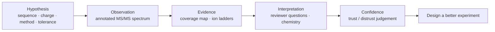
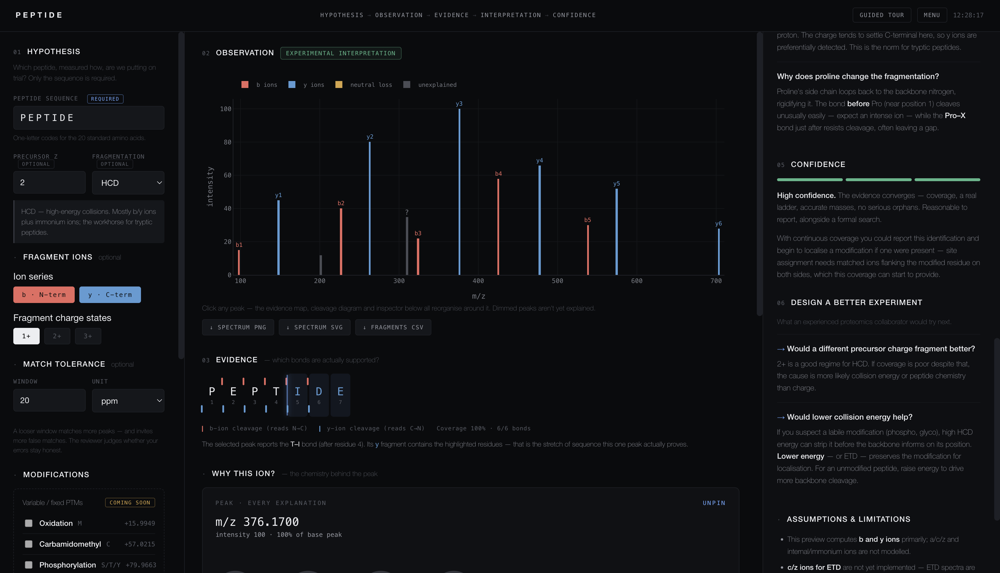

# PEPTIDE

an interactive interpreter for reasoning about peptide MS/MS fragmentation. PEPTIDE allows users to inspect a tandem mass (MS/MS) spectrum and reason about whether a proposed peptide identification should be *trusted or distrusted*. it calculates theoretical b/y fragment ions, matches them to an observed spectrum, and — rather than stopping at annotation — explains **why** each ion exists, weighs the evidence a reviewer would demand, and suggests what experiment to run next.


---

## Overview

most fragment-ion tools answer *"what is this peak?"* PEPTIDE is built around a different question: *"how much should I believe this identification, and why?"*

the application is a single, self-contained web page. given a peptide sequence and an observed peak list, it:

- computes theoretical fragment ions from monoisotopic amino-acid masses,
- matches them to observed peaks within a user-defined tolerance,
- draws an interactive, annotated spectrum and a sequence-coverage map,
- explains the underlying fragmentation chemistry in plain language, and
- summarises the strength of the evidence

the interface follows the scientific method as a workflow: **Hypothesis → Observation → Evidence → Interpretation → Confidence.**

---

## workflow



---

## installation

PEPTIDE is a single HTML file with no build step.

```bash
git clone https://github.com/sprudhvi728/peptide.git
cd peptide
# open the file in any modern browser:
open peptide.html      # macOS
# or: xdg-open peptide.html   (Linux) / start peptide.html (Windows)
```

alternatively, download `peptide.html` and open it directly, or serve the folder locally (e.g. `python3 -m http.server`) and visit the page.

**Note:** the page loads React, Plotly, and Babel from a public CDN, so an internet connection is required the first time it is opened. No data leaves the browser — all calculation happens client-side.

---

## required input format

PEPTIDE currently accepts two inputs, entered directly in the application:

1. **peptide sequence** — one-letter amino-acid codes (the 20 standard residues), e.g. `PEPTIDE`.
2. **observed spectrum (optional)** — a pasted peak list, one peak per line, as `m/z,intensity` pairs:

   ```
   148.06,45
   263.09,80
   376.17,100
   ```

   whitespace-separated values are also accepted. If no spectrum is provided, PEPTIDE displays the theoretical prediction only.

**direct import of vendor or repository files (mzML, MGF) is not yet implemented.** See the [Roadmap](#roadmap). support is *designed* to parse mzML in a future release; compatibility may vary depending on vendor and export format, and future testing will include larger vendor-converted mzML files.

---

## analysis pipeline

1. **parse** the peptide sequence into residues (`parsePeptide`).
2. **enumerate** theoretical b and y ions at the requested charge states, including licensed neutral losses (`calculateBIons`, `calculateYIons`, `calculateNeutralLosses`, `calculateMz`).
3. **match** theoretical ions to observed peaks within the selected tolerance, retaining all candidate annotations per peak (`matchObservedPeaks`).
4. **score** the match: coverage, ladder length, explained intensity, and mass-error statistics (`calculateCoverage`, and metric helpers).
5. **reason** over the result: generate the reviewer questions, chemistry explanations, and experiment suggestions, and synthesise a confidence judgement.

all mass constants and formulas are defined transparently and commented in the source (`peptide.html`), including the proton, water, and ammonia masses and the monoisotopic residue table.

### fragment ion formulas (monoisotopic)

- **b ion** neutral mass = Σ(residue masses of the N-terminal fragment)
- **y ion** neutral mass = Σ(residue masses of the C-terminal fragment) + H₂O
- **observed m/z** = (neutral mass + z · proton) / z

---

## reference data

PEPTIDE does **not** query external sequence or spectral databases. all calculations use built-in tables:

- monoisotopic residue masses for the 20 standard amino acids,
- monoisotopic masses of the proton, water (H₂O), and ammonia (NH₃),
- a reserved constant for phosphoric acid (H₃PO₄) for planned phosphorylation support.

these values follow standard elemental monoisotopic masses as used throughout proteomics. because nothing is looked up remotely, results are fully reproducible offline once the page has loaded.

---

## screenshots



| Region | Stage | Contents |
| --- | --- | --- |
| left | hypothesis | sequence, precursor charge, fragmentation method, ion/charge selection, tolerance, spectrum input |
| centre | observation → evidence | annotated interactive spectrum, coverage map, cleavage inspector, fragment ledger |
| right | interpretation → confidence | conclusions, reviewer questions, chemistry, confidence, experiment suggestions |

---

## downloadable outputs

- **annotated spectrum (PNG)** — the interactive plot includes a toolbar (top-right) with a *download as PNG* option.
- **fragment table and reasoning export (CSV / report)**

---

## example dataset

no separate dataset file is shipped with the repository yet. the application includes a **built-in worked example** (the *Load worked example* button), using the peptide `PEPTIDE` with the following illustrative singly-charged peak list:

```
98.06,15     227.10,40    324.16,22    425.20,58    538.29,30
148.06,45    263.09,80    376.17,100   477.22,66    574.27,52
703.31,28    310.10,35    201.05,12
```

this example is intended for demonstration and teaching; it is a hand-constructed peak list, not an experimental acquisition.

---

## biological interpretation

a fragment spectrum is only useful if it lets you make — or withhold — a biological claim with the right level of confidence. PEPTIDE frames its output accordingly:

- **continuous, bilateral coverage** (b and y ions bracketing each residue) is the basis for reading a sequence with confidence and for beginning to localise a modification, which additionally requires matched ions flanking the modified residue.
- **partial or one-sided coverage** may be enough to shortlist a peptide but not to attribute a function, variant, or modification to it — ambiguous regions are where a wrong residue or misplaced modification hides.
- **sparse coverage or unexplained intense peaks** should prompt caution: near-isobaric sequences and co-isolated precursors can mimic weak evidence.

the tool makes these consequences explicit so that interpretation is tied to evidence rather than to a single score.

---

## intended use

PEPTIDE is intended for:

- **hypothesis generation** and manual inspection of MS/MS spectra,
- **teaching** the chemistry and logic of peptide fragmentation, and
- **critical review** of a proposed identification before or alongside a formal search.

it is **not** intended as a replacement for validated database search engines, statistical confidence estimation (e.g. target–decoy FDR), or reporting-grade identification software. Any conclusion drawn in PEPTIDE should be confirmed with established tools and orthogonal experimental evidence. Treat it as an expert collaborator that helps you reason — not as an authority that certifies results.

---

## references

1. Roepstorff, P. & Fohlman, J. (1984). Proposal for a common nomenclature for sequence ions in mass spectra of peptides. *Biomedical Mass Spectrometry*, 11(11), 601.
2. Biemann, K. (1988). Contributions of mass spectrometry to peptide and protein structure. *Biomedical & Environmental Mass Spectrometry*, 16(1–12), 99–111.
3. Steen, H. & Mann, M. (2004). The ABC's (and XYZ's) of peptide sequencing. *Nature Reviews Molecular Cell Biology*, 5(9), 699–711.
4. Wysocki, V. H., Tsaprailis, G., Smith, L. L. & Breci, L. A. (2000). Mobile and localized protons: a framework for understanding peptide dissociation. *Journal of Mass Spectrometry*, 35(12), 1399–1406.
5. Breci, L. A., Tabb, D. L., Yates, J. R. & Wysocki, V. H. (2003). Cleavage N-terminal to proline: analysis of a database of peptide tandem mass spectra. *Analytical Chemistry*, 75(9), 1963–1971.
6. Syka, J. E. P., Coon, J. J., Schroeder, M. J., Shabanowitz, J. & Hunt, D. F. (2004). Peptide and protein sequence analysis by electron transfer dissociation mass spectrometry. *PNAS*, 101(26), 9528–9533.
7. Olsen, J. V., Macek, B., Lange, O., Makarov, A., Horning, S. & Mann, M. (2007). Higher-energy C-trap dissociation for peptide modification analysis. *Nature Methods*, 4(9), 709–712.

---
